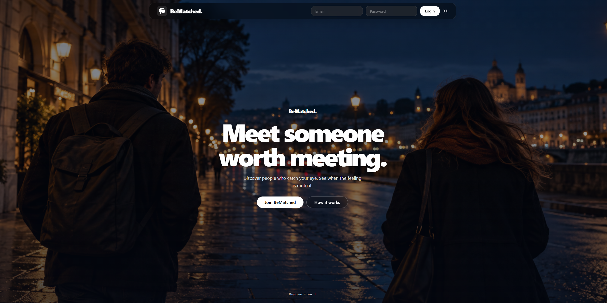

<h1 align="center">BeMatched</h1>

<p align="center">
  <strong>Discover people. Find mutual interest. Make a connection.</strong>
</p>

<p align="center">
  A full-stack dating app for discovering members, connecting through mutual likes, and messaging in real time.
</p>

<p align="center">
  
  
  
  
  
  
  
  
</p>

<p align="center">
  
</p>

## Contents

- [Features](#-features)
- [Technology](#-technology)
- [Live messaging and presence](#-live-messaging-and-presence)
- [Getting started](#-getting-started)
- [Project structure](#-project-structure)
- [Roadmap](#-roadmap)

## ✨ Features

- **Member discovery** — browse profiles with server-side pagination, age and gender filters, and sorting by recent activity or join date. Filter preferences persist in the browser.
- **Profiles and photos** — update profile details, upload photos through Cloudinary, and choose a main photo.
- **Likes and lists** — like or unlike members and browse **Mutual**, **Liked**, and **Liked me** lists.
- **Live messaging** — send messages through an authenticated SignalR hub. Conversations update as messages arrive, recipients get clickable toast notifications, and profile cards show online status.
- **Account and role management** — register and sign in with ASP.NET Core Identity. JWT access tokens, an HttpOnly refresh-token cookie, and role-based authorization support member, moderator, and admin access. Admins can manage user roles.

## 🧰 Technology

| Area | Technologies |
| --- | --- |
| Client | Angular standalone components, TypeScript, RxJS, Tailwind CSS, DaisyUI |
| API | ASP.NET Core Web API, ASP.NET Core Identity, JWT authentication, SignalR |
| Data | Entity Framework Core, SQLite |
| Photo storage | Cloudinary |

## 💬 Live messaging and presence

The authenticated client connects to the API at `/hubs/presence`. When a message is sent, the API saves it to the database before publishing a SignalR event to the sender and recipient. The recipient's open conversation updates immediately and displays a notification that links to the conversation.

SignalR provides live delivery and connection presence; the database remains the message history. A recipient who was offline can load saved messages when they return. Presence is tracked in memory by the API process, so a multi-instance deployment would need shared presence state and SignalR scale-out support.

## 🚀 Getting started

### Prerequisites

- .NET 10 SDK
- Node.js and npm
- A trusted local HTTPS certificate
- Cloudinary credentials for photo uploads and deletion

### Run the API

From the repository root:

```bash
dotnet run --project API --launch-profile https
```

The API runs at `https://localhost:5001`. On first start, it applies EF Core migrations and seeds demo accounts if the database is empty. The included development configuration is for local development; use your own secrets outside development.

### Run the client

In another terminal:

```bash
cd Client
npm ci
npm start
```

Open `https://localhost:4200`. The Angular development server uses `Client/ssl/localhost.pem` and `Client/ssl/localhost-key.pem`; use a locally trusted certificate and key if the included development certificate is not trusted by your browser.

Sign in with a seeded account such as `lisa@test.com` / `Pa$$w0rd`, or register a new account. Seeded credentials are for local development only. To try live messaging, sign in as two different users in separate browser profiles.

For photo uploads, configure `CloudinarySettings:CloudName`, `CloudinarySettings:ApiKey`, and `CloudinarySettings:ApiSecret` through local user secrets or environment variables. API request examples are available in [`API/likesRequests.http`](API/likesRequests.http) and can be run with the VS Code REST Client extension.

## 🗂️ Project structure

| Path | Purpose |
| --- | --- |
| [`API/Controllers`](API/Controllers) | HTTP endpoints for accounts, members, likes, messages, and administration |
| [`API/Data`](API/Data) | EF Core context, repositories, migrations, and demo seed data |
| [`API/SignalR`](API/SignalR) | Authenticated presence and live-message hub |
| [`API/Services`](API/Services) | Shared services, including message persistence and live notifications |
| [`Client/src/features`](Client/src/features) | Member, messaging, lists, and administration screens |
| [`Client/src/core`](Client/src/core) | API and SignalR services, authentication, guards, and interceptors |

## 🛣️ Roadmap

- Unit of Work
